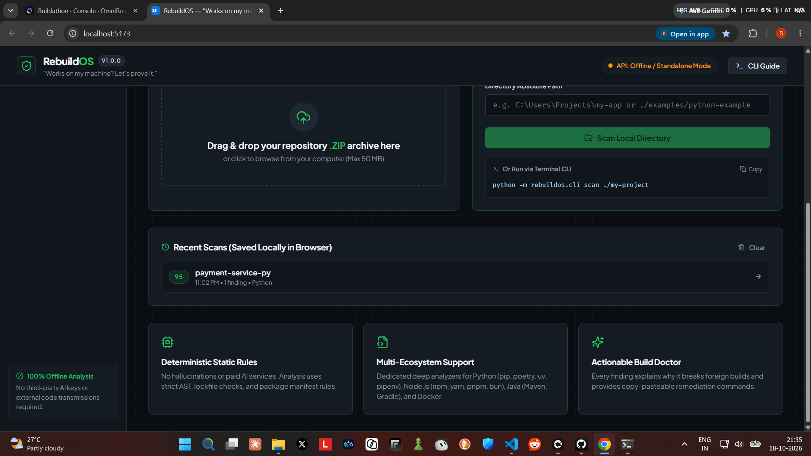
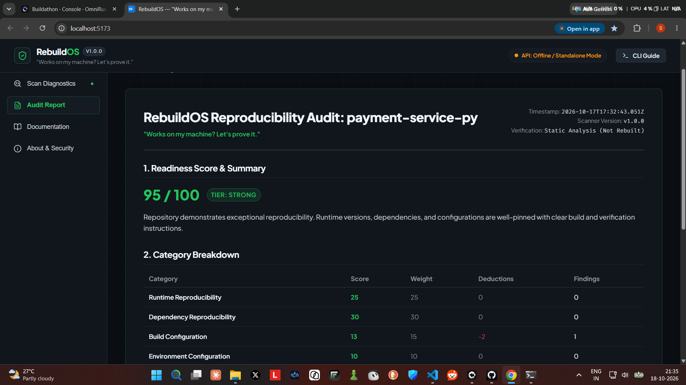
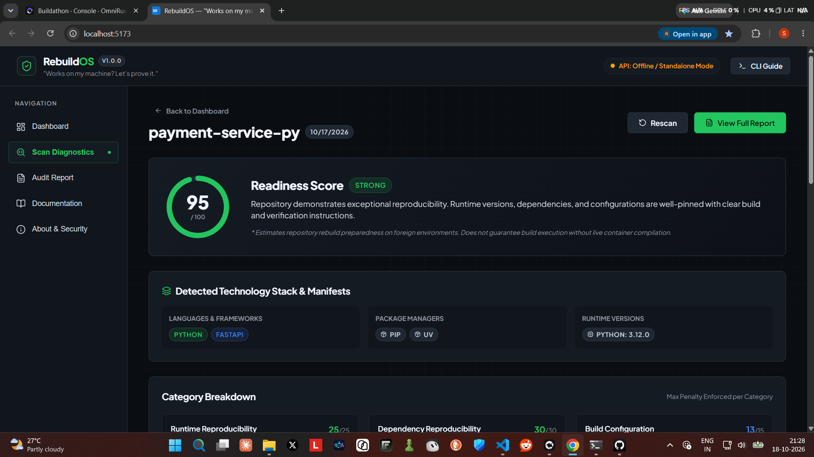
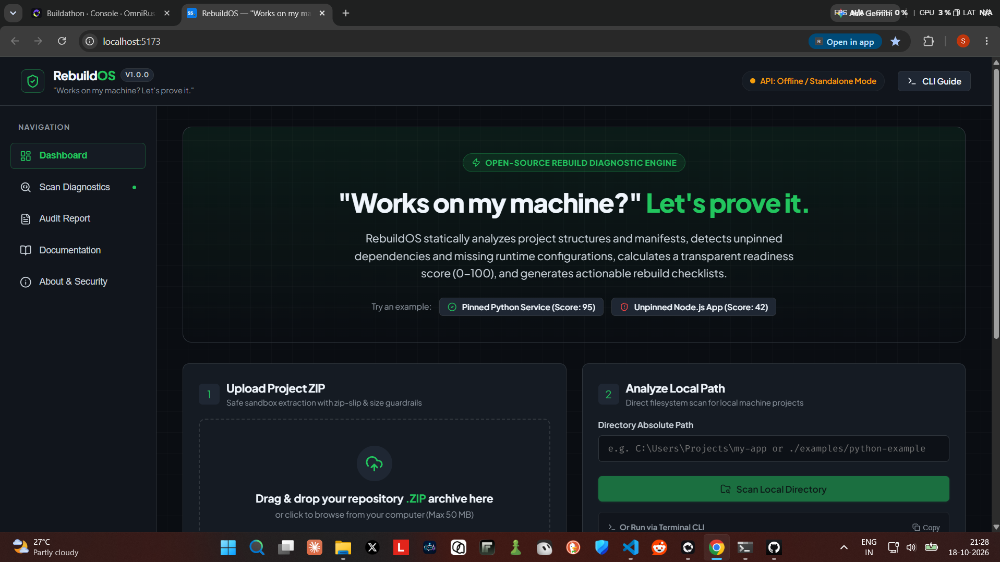
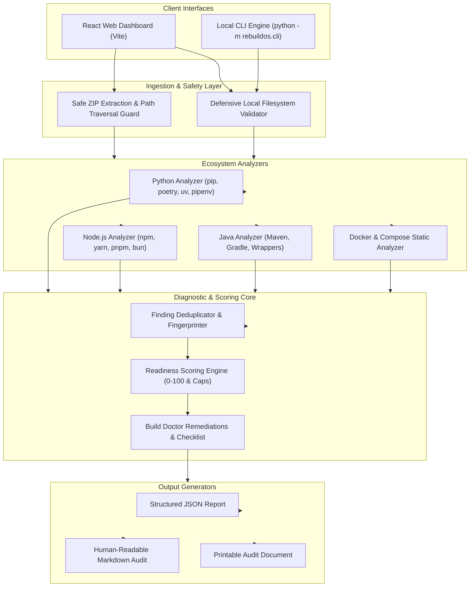

# RebuildOS

> **"Works on my machine? Let's prove it."**

[](https://github.com/placeholder-user/rebuildos/actions)
[](https://opensource.org/licenses/MIT)
[](https://www.python.org/downloads/)
[](https://nodejs.org/)

---

## 1. Problem Statement

Developers frequently submit repositories for hackathons, code reviews, job applications, or open-source distribution that fail immediately when opened on another engineer's machine. The reasons are painfully familiar:

- **Unpinned or Missing Dependencies**: Loose `>=` dependencies or missing lockfiles (`package-lock.json`, `poetry.lock`) that install newer breaking versions tomorrow.
- **Undocumented Environment Variables**: Code referencing `process.env.API_SECRET` or `os.environ["DATABASE_URL"]` with no `.env.example` template provided.
- **Ambiguous Runtime Releases**: No `.python-version`, `.nvmrc`, or compiler versions declared, leading to syntax or C-extension failures.
- **Missing Build & Test Scripts**: Repositories containing buildable frameworks (React, Vite, TypeScript) without a `build` or `test` command.
- **Container Flaws**: `Dockerfile` images using floating `:latest` tags or lacking `.dockerignore` files that accidentally commit local secrets and gigabytes of `node_modules`.

## 2. Product Overview

**RebuildOS** is an open-source, local-first developer tool that evaluates repository reproducibility and build readiness. It inspects project structures, detects configuration vulnerabilities, calculates a transparent 0–100 Readiness Score, explains findings with actionable "Why it matters" rationales, and generates interactive rebuild checklists and audit reports.

**100% Offline & Deterministic**: RebuildOS requires **no paid APIs**, **no cloud AI keys**, and **no database accounts**. All analysis runs locally in milliseconds.

---

## 3. Core Features

- 🔍 **Multi-Ecosystem Analyzers**: Built-in deterministic static checkers for Python (pip, poetry, uv, pipenv), Node.js (npm, yarn, pnpm, bun), Java (Maven, Gradle), and Docker.
- 🎯 **Readiness Score Engine (0–100)**: Transparent weighted scoring across 6 categories with deduplication and maximum per-category penalty caps.
- 🩺 **Build Doctor**: Explains the exact reproducibility impact of every issue and provides copy-pasteable remediation commands.
- 📋 **Personalized Rebuild Checklist**: Interactive browser session checklist distinguishing manual user fixes from automatically verified checks.
- 🛡️ **Zip Slip & Zip Bomb Guard**: Safe archive sandbox extraction with path traversal defense, file count limits, and uncompressed size boundaries.
- 💻 **Terminal CLI**: Run scans locally inside CI/CD or local terminals via `python -m rebuildos.cli scan ./my-project`.
- 📄 **Exportable Audit Reports**: One-click downloads of structured JSON reports and GitHub-ready Markdown summaries.

---

## 4. Screenshots

> *Placeholder previews until demo screenshots are captured:*

| Dashboard & Scan Entry | Diagnostic Findings & Score |
| :---: | :---: |
|  *Hero uploader, local path scanner, and preset selector* |  *Readiness dial, category breakdown, and Build Doctor* |

| Interactive Rebuild Checklist | Print-Ready Audit Report |
| :---: | :---: |
|  *Interactive remediation checkboxes and verified checks* |  *Printable executive report with Markdown/JSON export* |

---

## 5. Architecture & System Design



---

## 6. Technology Stack

- **Frontend**: React 18, Vite, Modern Vanilla CSS & Theme Variables, Lucide Icons.
- **Backend API**: Python 3.12, FastAPI, Pydantic v2 (strict request/response validation), Starlette, Uvicorn.
- **Shared Analysis Core**: Python standard library (`zipfile`, `pathlib`, `tempfile`), Regex AST heuristics.
- **Testing**: Pytest automated suite (30 comprehensive tests covering analyzers, security, scoring, API, and CLI).
- **Infrastructure**: Docker, Docker Compose, GitHub Actions CI workflow.

---

## 7. Project Structure

```text
rebuildos/
├── backend/
│   ├── app/
│   │   ├── analyzers/         # Python, Node.js, Java, and Docker analyzers
│   │   │   ├── base.py
│   │   │   ├── python_analyzer.py
│   │   │   ├── node_analyzer.py
│   │   │   ├── java_analyzer.py
│   │   │   └── docker_analyzer.py
│   │   ├── core/              # Config constants, security bounds, scoring engine
│   │   │   ├── config.py
│   │   │   ├── security.py
│   │   │   └── scoring.py
│   │   ├── models/            # Pydantic data schemas
│   │   │   └── schemas.py
│   │   ├── services/          # Scanner orchestration & report formatting
│   │   │   ├── scanner.py
│   │   │   └── report_service.py
│   │   └── main.py            # FastAPI REST API entry point
│   ├── rebuildos/             # Standalone CLI package
│   │   ├── __init__.py
│   │   ├── __main__.py
│   │   └── cli.py
│   ├── tests/                 # Automated pytest suite & fixture repositories
│   │   ├── conftest.py
│   │   ├── fixtures/
│   │   ├── test_api.py
│   │   ├── test_cli.py
│   │   ├── test_docker_analyzer.py
│   │   ├── test_java_analyzer.py
│   │   ├── test_node_analyzer.py
│   │   ├── test_python_analyzer.py
│   │   ├── test_reports.py
│   │   ├── test_scoring.py
│   │   └── test_security_zip.py
│   ├── pyproject.toml
│   ├── requirements.txt
│   ├── requirements.lock      # Pinned dependency lockfile
│   └── Dockerfile
├── frontend/
│   ├── public/                # Favicon and static assets
│   ├── src/
│   │   ├── components/        # Gauge, Breakdown, TechBadges, Checklist, FindingCard
│   │   ├── pages/             # Dashboard, Results, Report, Docs, About
│   │   ├── services/          # API client and offline mock presets
│   │   ├── styles/            # Theme variables and global stylesheet
│   │   ├── App.jsx
│   │   └── main.jsx
│   ├── package.json
│   ├── package-lock.json
│   ├── vite.config.js
│   └── Dockerfile
├── examples/
│   ├── python-example/        # Fully reproducible Python FastAPI microservice
│   └── node-example/          # Fully reproducible Node.js service
├── docs/
│   ├── ARCHITECTURE.md        # Detailed system design
│   ├── SECURITY.md            # Threat model and mitigation specs
│   └── CONTRIBUTING.md        # Open-source contribution guidelines
├── .github/
│   └── workflows/
│       └── tests.yml          # Automated CI pipeline
├── .gitignore
├── .dockerignore
├── .env.example
├── docker-compose.yml
├── Makefile
├── README.md
└── LICENSE
```

---

## 8. Installation & Quickstart

### Prerequisites
- Python 3.10+ (Python 3.12 recommended)
- Node.js 18+ (Node 20+ recommended)
- Git

### 1. Clone the Repository
```bash
git clone https://github.com/placeholder-user/rebuildos.git
cd rebuildos
```

### 2. Run the Backend API
```bash
cd backend
python -m venv .venv

# Activate virtual environment
# Windows:
.venv\Scripts\activate
# macOS/Linux:
source .venv/bin/activate

# Install pinned dependencies
pip install -r requirements.lock

# Start FastAPI server
python -m uvicorn app.main:app --reload --port 8000
```
*API documentation will be available at [http://localhost:8000/api/docs](http://localhost:8000/api/docs).*

### 3. Run the Frontend Web Application
In a new terminal:
```bash
cd frontend
npm install
npm run dev
```
*Open your browser at [http://localhost:5173](http://localhost:5173).*

---

## 9. Docker Deployment

If Docker and Docker Compose are installed on your machine, launch the entire application with a single command:

```bash
docker compose up --build
```
- Web Application: `http://localhost:5173`
- Backend API: `http://localhost:8000`

---

## 10. CLI Usage Reference

Scan any local directory directly from your terminal:

```bash
# Standard human-readable terminal audit
python -m rebuildos.cli scan ./my-project

# Export structured JSON report
python -m rebuildos.cli scan ./my-project --format json --output audit.json

# Export Markdown summary
python -m rebuildos.cli scan ./my-project --format markdown --output AUDIT.md

# Fail with non-zero exit code if score < 80
python -m rebuildos.cli scan ./my-project --min-score 80

# Strict mode: fail on any warnings or critical findings
python -m rebuildos.cli scan ./my-project --strict
```

### Exit Codes
- `0`: Success — Project achieved required readiness score without critical issues.
- `1`: Failure — Critical issues detected or readiness score below minimum threshold.
- `2`: Invalid argument or path does not exist.
- `3`: Fatal internal analysis error.

---

## 11. REST API Endpoints

| Method | Endpoint | Description |
| :--- | :--- | :--- |
| `GET` | `/api/health` | Health check endpoint returning `{ status: "ok" }`. |
| `GET` | `/api/version` | Returns RebuildOS version and execution modes. |
| `GET` | `/api/capabilities` | Lists supported ecosystems, manifests, and rules. |
| `POST` | `/api/scan` | Uploads and scans a `.zip` repository archive. |
| `POST` | `/api/scan/local` | Scans a local filesystem directory on the machine. |
| `POST` | `/api/report` | Exports audit reports in JSON or Markdown format. |
| `GET` | `/api/docs` | Swagger interactive API documentation in browser. |

---

## 12. Supported Ecosystems & Analyzers

### Python Analyzer
- **Manifests**: `requirements.txt`, `pyproject.toml`, `Pipfile`, `setup.py`.
- **Lockfiles**: `poetry.lock`, `uv.lock`, `Pipfile.lock`, `requirements.lock`.
- **Checks**: Unpinned dependencies (`==`), missing runtime declarations (`.python-version`, `runtime.txt`), missing `.env.example`, missing test suites (`pytest`), and committed `.env` secrets.

### Node.js / TypeScript Analyzer
- **Manifests**: `package.json`.
- **Lockfiles**: `package-lock.json`, `yarn.lock`, `pnpm-lock.yaml`, `bun.lockb`, `bun.lock`.
- **Checks**: Missing lockfiles, conflicting lockfiles, `engines.node` and `.nvmrc` presence, missing `build` or `test` scripts, malformed JSON syntax, committed `node_modules`, and `.gitignore` hygiene.

### Java / JVM Analyzer
- **Manifests**: `pom.xml` (Maven), `build.gradle`, `build.gradle.kts` (Gradle).
- **Wrappers**: `mvnw`, `mvnw.cmd`, `.mvn/wrapper/`, `gradlew`, `gradlew.bat`.
- **Checks**: Missing wrappers, missing compiler/runtime source versions (`<java.version>`, `sourceCompatibility`), missing test directory (`src/test`).

### Docker Analyzer
- **Manifests**: `Dockerfile`, `Dockerfile.*`, `docker-compose.yml`, `compose.yaml`.
- **Checks**: Floating base tags (`:latest`, `:alpine` without language minor), missing `.dockerignore`, sub-optimal layer caching (copying source before installing dependencies), containers running as `root` without `USER` directive.

---

## 13. Scoring Methodology

Every project begins with a baseline of **100 points**. Deductions subtract points based on finding severity:
- **Critical Issue**: `-15 points`
- **Warning**: `-7 points`
- **Informational**: `-2 points`

### Category Weights & Caps
| Category | Weight | Max Penalty |
| :--- | :---: | :---: |
| Dependency Reproducibility | 30 pts | 30 pts |
| Runtime Reproducibility | 25 pts | 25 pts |
| Build Configuration | 15 pts | 15 pts |
| Environment Configuration | 10 pts | 10 pts |
| Documentation & Setup | 10 pts | 10 pts |
| Test & Verification Readiness | 10 pts | 10 pts |

*Per-category penalty caps prevent multiple related findings from driving a category score below 0.*

### Readiness Tiers
- **90–100**: `Strong` — Excellent pinning, complete lockfiles, verified test suite.
- **75–89**: `Good` — Minor improvements recommended in runtime declarations or docs.
- **50–74**: `Needs work` — Missing lockfiles or unpinned dependencies pose notable risks.
- **0–49**: `High risk` — Severe lack of manifests, lockfiles, or installation instructions.

---

## 14. Security Safeguards

- **Zip Slip Defense**: Normalized path resolution verifies every archive entry remains strictly within the temporary directory.
- **Archive Limits**: Max 50 MB zip size, max 10,000 files, max 200 MB uncompressed.
- **No Automatic Script Execution**: Analysis is strictly static; no project scripts or setup files are ever run.
- **Safe Temporary Files**: Isolated temporary folders automatically destroyed after analysis.

---

## 15. Running Automated Tests

Run the complete backend test suite:
```bash
cd backend
python -m pytest
```
*Current test suite: **30 passed tests** covering all analyzers, security constraints, scoring caps, API endpoints, and CLI execution.*

Verify frontend production build:
```bash
cd frontend
npm run build
```

---

## 16. Known Limitations

- **Static Analysis vs. Live Sandbox**: RebuildOS performs static inspection. It detects missing dependencies and configuration flaws but does not attempt a full containerized compilation in this tier.
- **Monorepo Depth**: Highly nested multi-package monorepos with internal workspace symlinks may have individual sub-packages analyzed as separate trees.
- **Compiled Binary Verification**: C/C++ native system libraries required by specific Python wheels cannot be fully verified without running the exact host distribution.

---

## 17. Roadmap

- [ ] Monorepo workspace graph visualization (Turborepo, Nx, Lerna).
- [ ] Auto-remediation PR generator: Automatically generate `.python-version`, `.env.example`, and `Dockerfile` PRs.
- [ ] Isolated container build sandbox: Optional Docker-in-Docker dry-run rebuild verification.
- [ ] Ecosystem expansions: Rust (Cargo), Go (Go modules), and Ruby (Bundler).

---

## 18. Contributing

Contributions are warmly welcomed! Please read [CONTRIBUTING.md](docs/CONTRIBUTING.md) and [SECURITY.md](docs/SECURITY.md) before opening a pull request.

---

## 19. License

This project is licensed under the [MIT License](LICENSE).

---

## 20. Author & Contact

Developed with care by **RebuildOS Maintainers**.
- GitHub: [@placeholder-developer](https://github.com/placeholder-developer)
- Project Category: Developer Tools & Open Source
