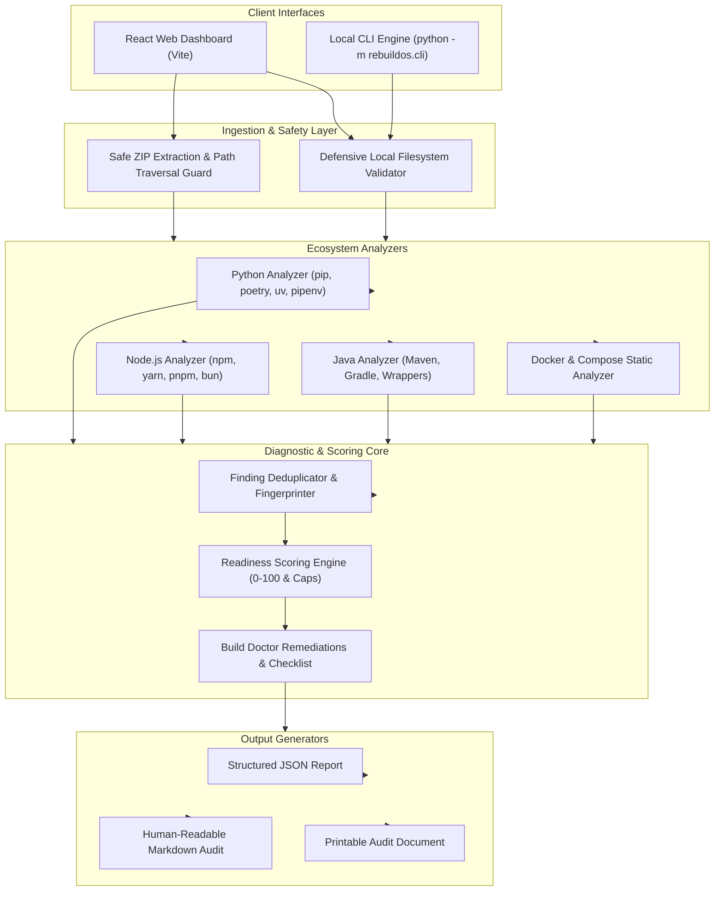

# RebuildOS Architecture & System Design

RebuildOS is architected as an **offline-first, deterministic reproducibility analysis platform**. It requires no paid APIs, external LLM calls, or database accounts.

## Core Modules

### 1. Ingestion & Security Boundary (`app/core/security.py`)
- Sanitizes incoming `.zip` archives.
- Rejects entries with relative path segments (`..`), absolute path markers, Windows drive prefixes (`C:`), or symlinks.
- Extracts files into an isolated temporary directory using `tempfile.mkdtemp()`.
- Guarantees immediate cleanup on exit via context manager.

### 2. Ecosystem Analyzers (`app/analyzers/`)
- **Python**: Detects `requirements.txt`, `pyproject.toml`, `Pipfile`, `.python-version`, `pytest.ini`, `.env.example`, unpinned dependencies, and missing test suites.
- **Node.js**: Detects `package.json`, lockfiles (`package-lock.json`, `yarn.lock`, `pnpm-lock.yaml`, `bun.lock`), `engines.node`, `.nvmrc`, test/build scripts, and conflicting lockfiles.
- **Java**: Detects `pom.xml`, `build.gradle`, wrapper scripts (`mvnw`, `gradlew`), Java release versions, and `src/test`.
- **Docker**: Inspects `Dockerfile` and `docker-compose.yml` for unpinned base tags (`:latest`), layer caching optimization, non-root users, and `.dockerignore`.

### 3. Readiness Scoring Engine (`app/core/scoring.py`)
- Calculates a transparent score from **0 to 100** across 6 weighted categories.
- Deduplicates identical findings across files.
- Enforces per-category penalty caps so single issues don't disproportionately skew the score.
